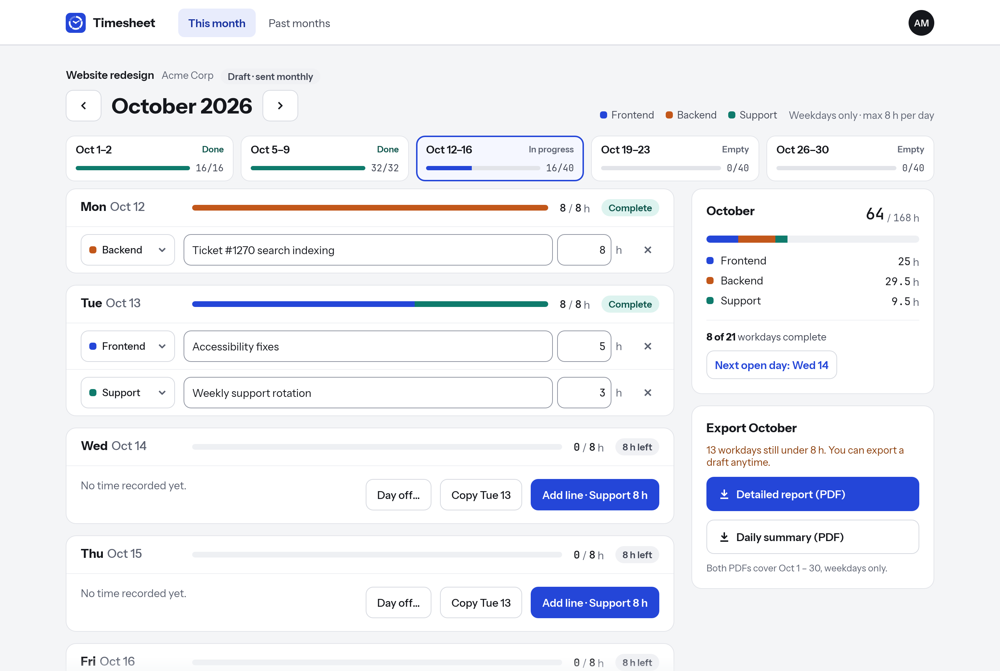
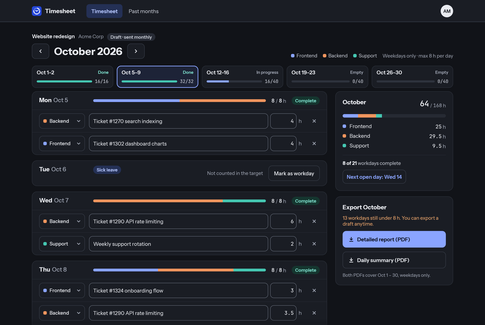
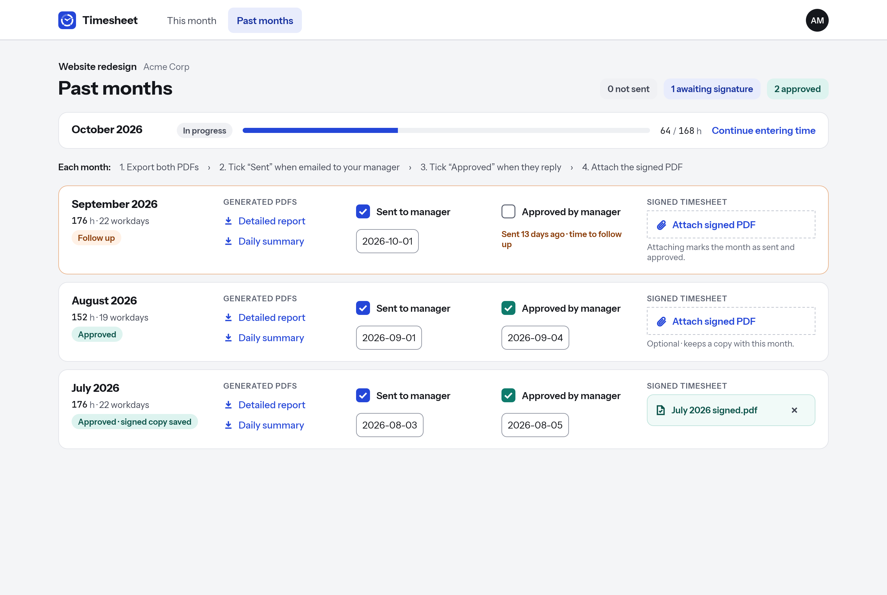
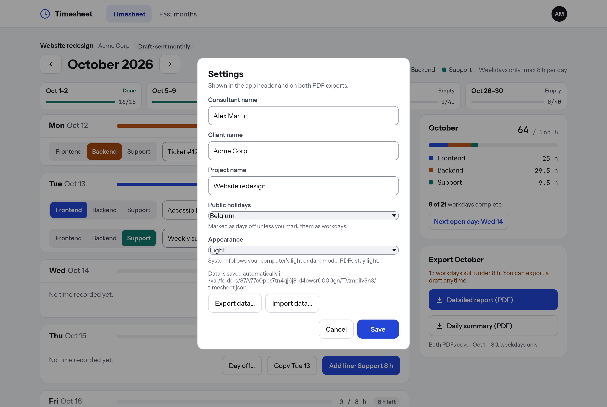
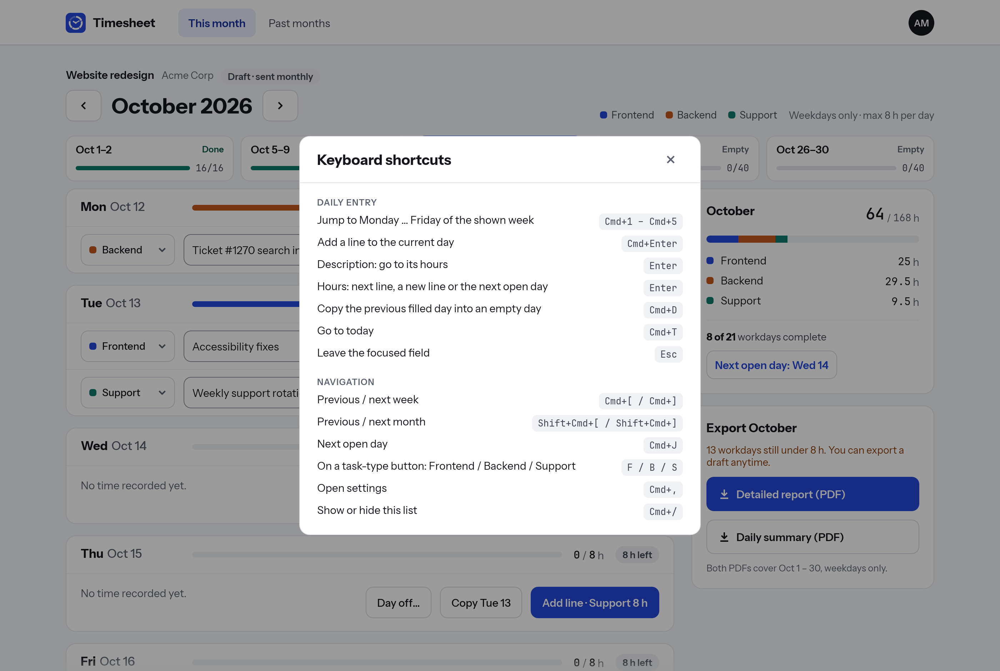

# Timesheet

Native desktop app (Rust, egui) for monthly timesheet entry on a single project, built from the
mockups in `mockups/` (not tracked by git). Runs on macOS and Windows.

- Weekdays only, at most 8 h per day, three task types (Frontend, Backend, Support).
- Exports two PDFs per month: **Detailed report** (every line, grouped by week) and
  **Daily summary** (hours per type per weekday).
- **Past months** tracks each closed month: export both PDFs, tick when sent to and approved by
  your manager (with dates), and attach the signed PDF. A month waiting more than 5 days for a
  reply is flagged for follow-up.
- An empty weekday can be marked as a day off (**Public holiday**, **Leave**, **Sick leave** or
  **Unpaid leave**). A day off counts 0 h, so the month and week targets drop by 8 h, and both PDFs
  show it as a labelled row.
- Consultant, client and project names are set in Settings (click the avatar). Choosing a country
  there (Belgium) marks its public holidays as days off; **Mark as workday** overrides one. Holidays
  are computed locally, without network access.
- **Appearance** in Settings picks **System** (default, follows the OS light or dark mode), **Light** or
  **Dark**. Both themes meet WCAG 2.2 AA contrast. PDFs always use the light colors.
- **Export data** and **Import data** in Settings move everything (lines, settings, approvals and
  signed PDFs) to another computer as one JSON file. Import replaces all current data, after saving it
  to a `timesheet.before-import-<date>.json` backup next to the data file.

## Keyboard shortcuts

`Cmd` is Command on macOS and Ctrl on Windows. `Cmd+/` shows this list in the app.

| Key | Action |
| --- | --- |
| `Cmd+1` … `Cmd+5` | Jump to Monday … Friday of the shown week. A weekday outside the month does nothing. |
| `Cmd+Enter` | Add a line to the current day and focus its description. |
| `Enter` in a description | Focus that line's hours. |
| `Enter` in hours | Focus the next line's description. On the last line: add a line if the day is under 8 h, else jump to the next open day. |
| `Cmd+D` | Copy the previous filled day into the current day, if it is empty. |
| `Cmd+T` | Go to today. |
| `Cmd+[` / `Cmd+]` | Previous / next week. |
| `Cmd+Shift+[` / `Cmd+Shift+]` | Previous / next month. |
| `Cmd+J` | Next open day. |
| `Cmd+,` | Open Settings. |
| `F` / `B` / `S` | On a focused task-type button: Frontend / Backend / Support. |
| `Esc` | Leave the focused field. |

The current day is the day holding the focused field or button. With nothing focused, it is today
when today is in the shown week, else the first open day of the week. Shortcuts do nothing while a
menu or dialog is open, and only `Cmd+/` and `Cmd+,` work outside This month.

## Screenshots











## Build and run

Install Rust from <https://rustup.rs>, then:

```sh
cargo run --release          # run
cargo build --release        # binary in target/release/timesheet(.exe)
cargo test                   # unit tests
cargo test -- --ignored      # writes sample October PDFs to target/ and README screenshots to docs/screenshots/
cargo fmt                    # format; CI fails on `cargo fmt --check`
```

Build the Windows `.exe` on a Windows machine with the same commands (MSVC toolchain).
Release builds on Windows open without a console window.

### macOS app

`cargo build --release` produces a bare binary. To get a `Timesheet.app` bundle:

```sh
cargo install cargo-bundle   # once
cargo bundle --release       # target/release/bundle/osx/Timesheet.app and dmg/Timesheet.dmg
```

Drag `Timesheet.app` to `/Applications`. Bundle settings are in `[package.metadata.bundle]` in `Cargo.toml`.

The app icon source is `assets/icon/icon.svg`. After you edit it, render the bundle PNGs and the Windows `icon.ico` again (macOS only; `build.rs`
embeds `icon.ico` in the `.exe`):

```sh
swift assets/icon/render.swift assets/icon/icon.svg assets/icon
```

The app is not signed. It opens normally on the Mac that built it. On another Mac, open it once with
right-click › **Open**, or System Settings › Privacy & Security › **Open Anyway**.

## CI and releases

`.github/workflows/ci.yml` builds and tests on macOS and Windows for every push to `main` and every pull request.

### Commit messages

Commits follow [Conventional Commits](https://www.conventionalcommits.org): `type(scope): description`,
for example `feat(export): add CSV export` or `fix: keep focus after copying a day`. Pull requests fail CI
if a commit subject does not match. Use `feat` and `fix` for user-facing changes: they become the
**Added** and **Fixed** entries of the changelog. `perf`, `refactor`, `revert` and `docs` are listed too;
`build`, `ci`, `chore`, `style` and `test` are left out. `feat!:` or a `BREAKING CHANGE:` footer marks a
breaking change.

### Releasing

`CHANGELOG.md` is generated from the commits by [git-cliff](https://git-cliff.org) (`cliff.toml`).
Install it once with `brew install git-cliff` or `cargo install git-cliff`, then:

```sh
scripts/release.sh
```

The script picks the next version from the commits since the last tag (`feat` bumps the minor version,
`fix` the patch version), prepends its section to `CHANGELOG.md`, sets the version in `Cargo.toml` and
`Cargo.lock`, and commits `chore(release): v<version>` on a `release/v<version>` branch. Edit the changelog
section if needed, open a pull request, and after merging push the tag it prints:

```sh
git switch main && git pull && git tag -a v<version> -m v<version> && git push origin v<version>
```

The workflow then attaches `Timesheet-v<version>-macos-universal.dmg` (Apple silicon and Intel) and
`Timesheet-v<version>-windows-x64.exe` to a new GitHub release, with that version's `CHANGELOG.md` section as
release notes. It fails if the tag does not match the `Cargo.toml` version or the changelog has no section for it.

## Data

All data is saved automatically after each change, as JSON:

- macOS: `~/Library/Application Support/Timesheet/timesheet.json`
- Windows: `%APPDATA%\Timesheet\data\timesheet.json`

Signed PDFs are copied next to it, in `signed/<year>-<month>.pdf`.

If the file cannot be read, it is renamed to `timesheet.corrupt-<timestamp>.json` (never overwritten)
and the app starts empty with a warning. If the file cannot be opened at all (for example, a permissions
problem), it is left untouched and changes are not saved until the app is restarted.

## Fonts

Instrument Sans and JetBrains Mono are embedded in the binary (SIL Open Font License, see `assets/fonts/`).
